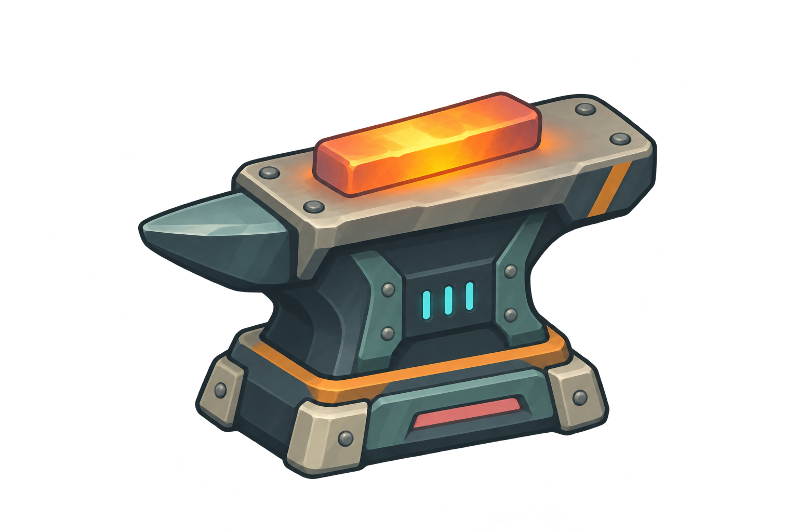

# Furnace Rhythm

**Working title.** A small 2D arcade game about forging parts to a beat. The project is pivoting from the larger factory simulation to a one-screen timing game that can be completed as a focused three-day prototype.

## The game

Take a five-order shift at a compact forge. Each workpiece moves through three beats—**Heat**, **Hammer**, and **Quench**. Press **Space** or click when the timing marker reaches the target band. Accurate hits build a streak and improve the score; missed beats lower the workpiece quality. Finish the shift to see the result and try again.

The target is a short, replayable run with one scene, one input, and one central timing mechanic. Movement, inventory, conveyor simulation, extra levels, and long-term progression are outside the first version.

## Scoring

Perfect hits earn 100 points, Good hits earn 60, and misses earn 0 and reset the streak. Consecutive hits add 10 combo points each, up to a 50-point bonus per hit.

The in-game HUD separates shift score, current streak/next-hit bonus, and workpiece count into palette-styled panels, with a five-segment progress strip and labeled Heat/Hammer/Quench indicators. Small flame, hammer, and water glyphs identify those phases. Score counts up, combo pips pulse, and the timing marker leaves a short phase-colored trail. Hits add a grade-colored flash and expanding impact ring; result cards pop in and fade away cleanly. Each workpiece result shows its three grades and points earned; the shift card shows rank, final score, grade totals, and best streak. Rounded panel skins and grade chips are generated from small code-drawn uGUI sprites, so the score UI needs no extra bitmap pack.

## Art direction

The 2D illustrations keep the established industrial palette and industrial material feel, using large readable shapes, dark outlines, restrained shading, and localized glow. The target brightens as the marker approaches; the billet floats subtly, with rising embers for Heat, an impact burst for Hammer, cyan steam for Quench, and a brief judgment pop.

| Use | Color | Hex |
| --- | --- | --- |
| Backgrounds and deep shadows | Midnight Industrial | `#1D3039` |
| Primary housings | Slate Machinery | `#526B70` |
| Secondary panels | Oxidized Teal | `#578F8C` |
| Light structures | Industrial Cream | `#C6C8B5` |
| Active timing and energy | Electric Cyan | `#62E3DD` |
| Heat and warnings | Safety Orange | `#E6A04F` |
| Special accents | Factory Coral | `#C96C70` |
| Optional advanced accent | Machine Violet | `#796098` |

### First sample asset

The hot billet on anvil is the first visual direction for the central gameplay object. It is a transparent PNG concept, not yet wired into a Unity scene.

## Project files

- [Three-day implementation plan](Docs/Implementation-Plan.md)
- [Hot billet sample asset](Assets/FurnaceRhythm/Art/FurnaceRhythm_HotBillet_Concept.png)

The old factory prototype scripts and screenshots have been removed. The runtime now supports the full five-order shift: fifteen beats, Perfect/Good/Miss scoring, a streak with capped combo bonus, per-workpiece quality, and a final shift result. Use **Furnace Rhythm → Build Day 1 Scene** in Unity to generate the scene, then press Play; the builder places it first in Build Settings.
